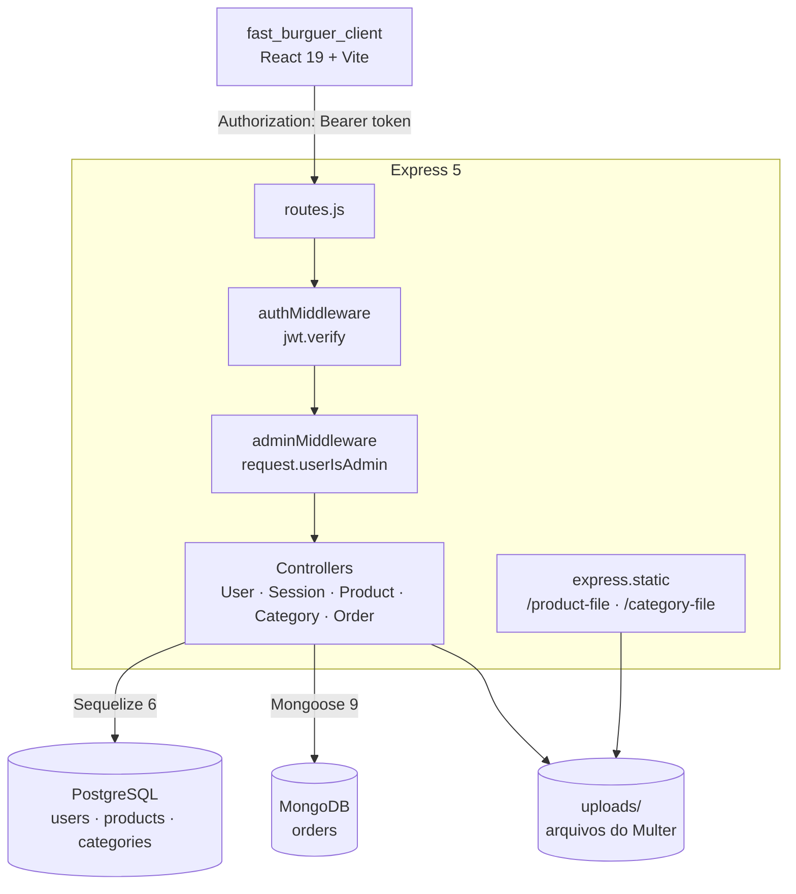
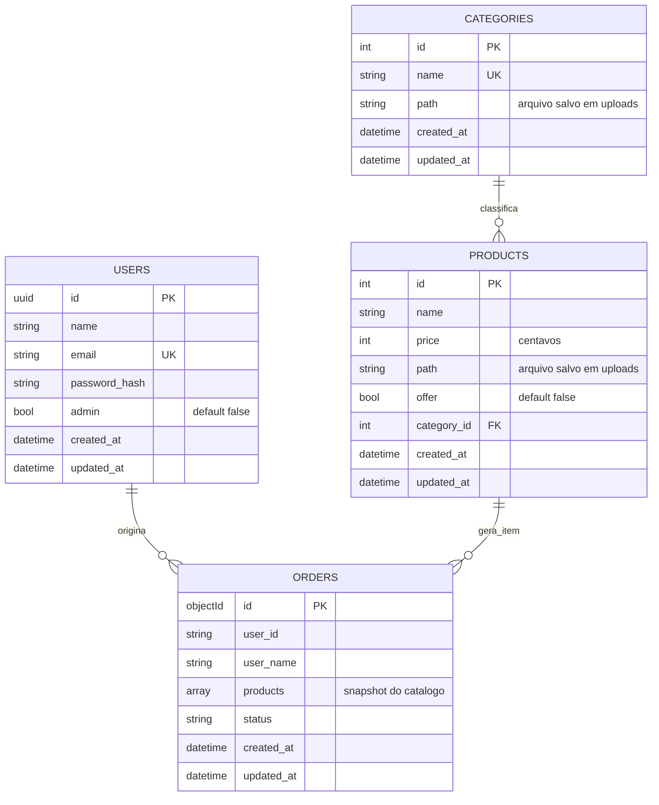
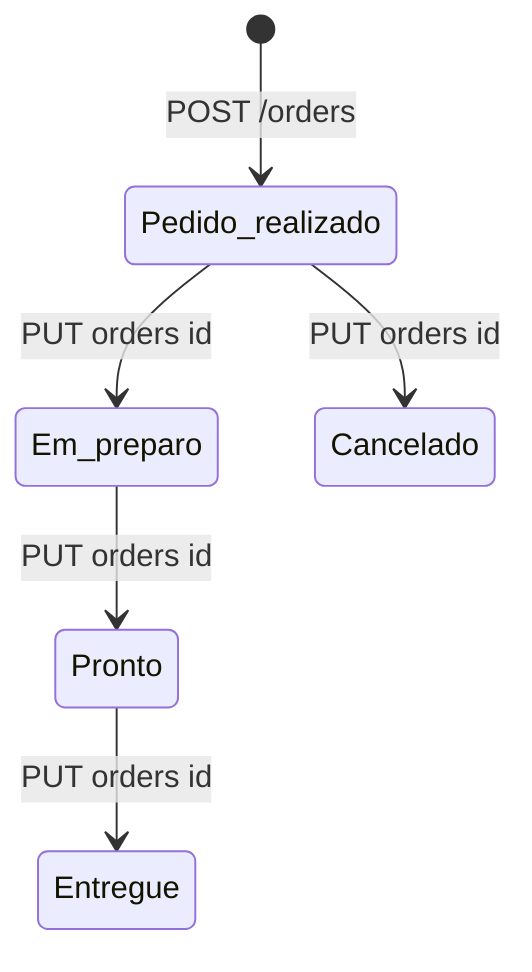
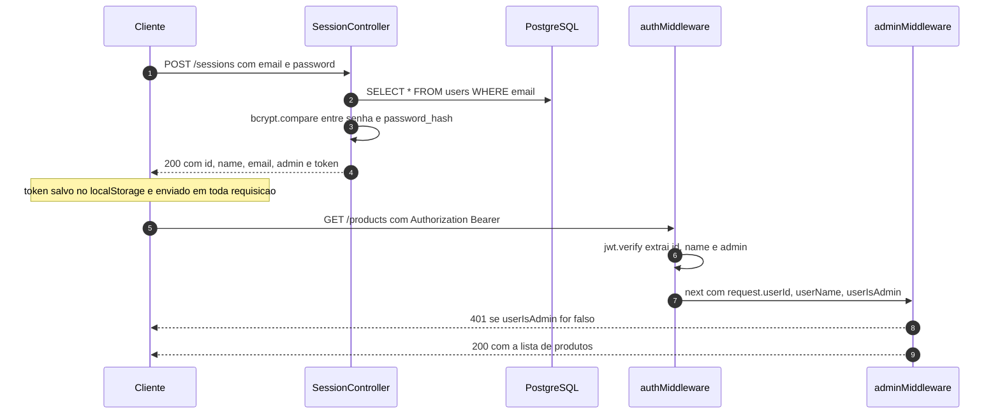

<div align="center">

# Fast Burguer API

**REST API de uma hamburgueria — cadastro e login de clientes, catálogo de produtos e categorias com upload de imagens, gestão de ofertas e registro de pedidos.**

`Node.js` · `Express 5` · `Sequelize 6` · `PostgreSQL` · `Mongoose 9` · `MongoDB` · `JWT` · `Multer` · `Yup` · `Biome` · `pnpm`

</div>

---

A **Fast Burguer API** é o backend do projeto [fast_burguer_client](https://github.com/gcastrodev/fast_burguer_client), uma aplicação fullstack de delivery de hamburgueria. O diferencial técnico do projeto está na **persistência poliglota**: o catálogo (usuários, produtos, categorias) vive em um banco relacional com integridade referencial, enquanto os pedidos são armazenados como documentos MongoDB com um *snapshot* congelado dos itens no momento da compra.

> Todo o conteúdo desta documentação — tabelas de endpoints, códigos de status e exemplos de requisição/resposta — foi **executado e validado contra a API rodando com PostgreSQL 18 e MongoDB reais**, não é descritivo apenas por leitura de código.

## Sumário

- [Sobre o projeto](#sobre-o-projeto)
- [Visão geral da arquitetura](#visão-geral-da-arquitetura)
- [Stack](#stack)
- [Estrutura de pastas](#estrutura-de-pastas)
- [Requisitos](#requisitos)
- [Instalação e execução](#instalação-e-execução)
- [Variáveis de ambiente](#variáveis-de-ambiente)
- [Modelo de dados](#modelo-de-dados)
- [Autenticação e autorização](#autenticação-e-autorização)
- [Referência dos endpoints](#referência-dos-endpoints)
- [Fluxo completo com curl](#fluxo-completo-com-curl)
- [Regras de negócio](#regras-de-negócio)
- [Decisões técnicas](#decisões-técnicas)
- [Estilo de código e qualidade](#estilo-de-código-e-qualidade)
- [Integração com o frontend](#integração-com-o-frontend)
- [Pontos de atenção e roadmap](#pontos-de-atenção-e-roadmap)
- [Licença](#licença)
- [Autor](#autor)

---

## Sobre o projeto

A API atende dois perfis de usuário distintos:

| Perfil | Flag `admin` | O que faz |
| --- | --- | --- |
| **Cliente** | `false` | Cria conta, faz login e consulta o catálogo (produtos e categorias) |
| **Administrador** | `true` | Além do acima, cadastra/edita produtos e categorias com imagens, controla a flag de oferta e gerencia o ciclo de vida dos pedidos |

Funcionalidades entregues:

- Cadastro de usuários com **e-mail único** e senha protegida por **bcrypt**
- Autenticação **stateless por JWT** (validade de 7 dias) com payload contendo `id`, `name` e `admin`
- Middleware de **autorização por papel** (`adminMiddleware`) separada da autenticação
- CRUD parcial de **produtos** e **categorias** com **upload de imagem** via Multer
- Campo `offer` para marcar produtos que entram no carrossel de ofertas do frontend
- Relacionamento **produto pertence a categoria** (`belongsTo`) com a categoria embutida na listagem
- **URL pública de imagem** gerada por atributo virtual do Sequelize a partir de `APP_URL`
- Criação de **pedidos** com snapshot de nome, preço, categoria, imagem e quantidade
- Atualização de **status do pedido** e listagem do histórico
- **CORS** liberado para consumo pelo cliente em origem diferente

## Visão geral da arquitetura



O ponto central é a **divisão entre os dois bancos**:

| Dados | Banco | Motivo |
| --- | --- | --- |
| `users`, `products`, `categories` | **PostgreSQL** | Estrutura estável, chaves estrangeiras, unicidade garantida no banco e consultas relacionais (produto + categoria em um único `JOIN`) |
| `orders` | **MongoDB** | Pedido é um agregado que precisa ser **imutável no tempo**: nomes, preços e imagens são copiados do catálogo no instante da compra, sem depender de joins futuros |

## Stack

| Camada | Tecnologia | Versão | Uso no projeto |
| --- | --- | --- | --- |
| Runtime | Node.js | 22.x | ES Modules com `"type": "module"` e `node --watch` no desenvolvimento |
| HTTP | Express | 5.2 | Router único, middlewares em cascata, `cors`, parser de JSON e urlencoded |
| ORM relacional | Sequelize | 6.37 | Modelos `User`, `Product`, `Category`, migrações e associação `belongsTo` |
| Driver SQL | pg / pg-hstore | 8.20 | Conexão com PostgreSQL |
| ODM | Mongoose | 9.6 | `OrderSchema` e conexão com MongoDB |
| Validação | Yup | 1.7 | Schemas por rota, com `abortEarly: false` para retornar todos os erros |
| Senha | bcrypt | 6.0 | Hash com custo 10 no cadastro e `compare` no login |
| Token | jsonwebtoken | 9.0 | Assinatura HS256 e verificação no middleware |
| Upload | Multer | 2.1 | `diskStorage` em `uploads/` com nome prefixado por UUID |
| Identidade | uuid | 14.0 | PK `UUIDv4` dos usuários e nomeação de arquivos |
| Config | dotenv | 17.4 | Variáveis de ambiente via `.env` |
| Estilo | Biome | 2.4 | Linter + formatador + organização de imports |
| Pacotes | pnpm | 11.x | `pnpm-lock.yaml` versionado |
| CLI de migração | sequelize-cli | 6.6 | `db:migrate`, `db:migrate:undo`, `db:migration:generate` |

## Estrutura de pastas

```
.
├── .sequelizerc.cjs                 # aponta config/modelos/migrações para o sequelize-cli
├── biome.json                       # linter e formatador (tab, aspas simples, imports organizados)
├── package.json                     # type: module, scripts e dependências
├── pnpm-lock.yaml
└── src
    ├── server.js                    # bootstrap: dotenv → app → conexões → listen(PORT)
    ├── app.js                       # cors, parsers, estáticos de upload e montagem das rotas
    ├── routes.js                    # todas as rotas e a aplicação das guards
    ├── config
    │   ├── auth.js                  # JWT_SECRET e expiresIn: 7d
    │   ├── database.cjs             # dialeto postgres, snake_case, timestamps
    │   ├── multer.cjs               # diskStorage em uploads/ + filename com UUID
    │   └── fileRoutes.cjs           # express.static apontando para uploads/
    ├── database
    │   ├── index.js                 # classe Database: init() (Sequelize) + mongo() (Mongoose)
    │   └── migrations/              # 7 migrações versionando o schema relacional
    └── app
        ├── models/                  # User, Product, Category (Sequelize)
        ├── schemas/                 # Order (Mongoose)
        ├── controllers/             # User, Session, Product, Category, Order
        └── middlewares/             # auth.js (JWT) e admin.js (papel)
```

> **Por que arquivos `.cjs` se o projeto é ESM?** O pacote declara `"type": "module"`, mas o `sequelize-cli` e as configurações lidas por `require()` precisam de CommonJS. A extensão `.cjs` resolve o conflito sem duplicar o projeto em dois sistemas de módulos.

## Requisitos

- **Node.js 20+** (testado em Node 22.23.4)
- **pnpm 9+** (testado em pnpm 11.25; o lockfile do projeto é do pnpm)
- **PostgreSQL** 16+ acessível na máquina
- **MongoDB** 6+ acessível na máquina
- Uma pasta `uploads/` — **criada automaticamente** pelo Multer no primeiro carregamento do módulo de rotas

## Instalação e execução

### 1. Clonar e instalar

```bash
git clone https://github.com/gcastrodev/fast_burguer_api.git
cd fast_burguer_api
pnpm install
```

### 2. Subir os bancos

Sem Docker, use suas instâncias locais. Com Docker:

```bash
docker run -d --name fb-postgres \
  -e POSTGRES_USER=postgres \
  -e POSTGRES_PASSWORD=postgres \
  -e POSTGRES_DB=fastburguer \
  -p 5432:5432 postgres:18-alpine

docker run -d --name fb-mongo \
  -p 27017:27017 mongo:8
```

### 3. Configurar o ambiente

```bash
cp .env.example .env   # e ajuste os valores
```

### 4. Rodar as migrações

O `sequelize-cli` só reconhece um arquivo exatamente chamado `.sequelizerc`. Como o projeto usa `.sequelizerc.cjs`, informe o caminho explicitamente:

```bash
pnpm exec sequelize db:migrate --options-path=./.sequelizerc.cjs
```

Saída esperada (7 migrações aplicadas):

```
Sequelize CLI [Node: 22.23.4, CLI: 6.6.5, ORM: 6.37.8]
Loaded configuration file "src/config/database.cjs".
== 20260519015449-create-users-table: migrated
== 20260530160305-create-products-table: migrated
== 20260601150151-create-categories-table: migrated
== 20260603131612-remove-category-column-from-product: migrated
== 20260603144428-add-column-category-id-to-product: migrated
== 20260605102831-include-offer-in-products: migrated
== 20260605151920-include-path-to-categories: migrated
```

Outros comandos úteis, sempre com a mesma flag:

```bash
pnpm exec sequelize db:migrate:status  --options-path=./.sequelizerc.cjs
pnpm exec sequelize db:migrate:undo    --options-path=./.sequelizerc.cjs
pnpm exec sequelize db:migrate:undo:all --options-path=./.sequelizerc.cjs
pnpm exec sequelize migration:generate --name nome-da-migracao --options-path=./.sequelizerc.cjs
```

### 5. Criar o primeiro administrador

Não há seed automático, então o primeiro admin é criado pela própria rota pública:

```bash
curl -X POST http://localhost:3000/users \
  -H 'Content-Type: application/json' \
  -d '{"name":"Gabriel Castro","email":"gabriel@example.com","password":"admin123","admin":true}'
```

### 6. Iniciar o servidor

```bash
pnpm dev
# Server is running on port 3000
```

## Variáveis de ambiente

| Variável | Obrigatória | Default | Descrição |
| --- | --- | --- | --- |
| `PORT` | não | — | Porta HTTP. Se ausente, o Express escuta em soquete aleatório |
| `APP_URL` | **sim** | — | Base usada pelo atributo virtual `url` das imagens. Sem ela, a resposta traz `undefined/product-file/...` |
| `JWT_SECRET` | **sim** | — | Chave de assinatura e verificação do token |
| `DB_HOST` | não | `localhost` | Host compartilhado por Postgres e Mongo |
| `DB_PORT_POSTGRES` | não | `5432` | Porta do PostgreSQL |
| `DB_PORT_MONGODB` | não | `27017` | Porta do MongoDB |
| `DB_USER` | **sim** | — | Usuário do PostgreSQL |
| `DB_PASSWORD` | **sim** | — | Senha do PostgreSQL |
| `DB_NAME` | **sim** | — | Database do PostgreSQL |

O banco do MongoDB é fixo no código (`fastburguer` em `src/database/index.js`) e a conexão não usa credenciais — suficiente para desenvolvimento, não para produção.

## Modelo de dados



Notas sobre o schema:

- O Sequelize está configurado com `underscored: true` e `underscoredAll: true`, então os atributos camelCase do código viram colunas `snake_case` no banco (`createdAt` → `created_at`).
- `PRODUCTS.category_id` tem `references` para `categories.id` com `ON UPDATE CASCADE` e `ON SET NULL`.
- `price` é `INTEGER` e representa **centavos**: o frontend divide por 100 e formata em `BRL`.
- `url` não é uma coluna: é um atributo `Sequelize.VIRTUAL` que concatena `APP_URL` + `/product-file` (ou `/category-file`) + `path`.
- `ORDERS` **não tem FK**: os produtos são copiados para dentro do documento. Mudar o preço de um produto depois não altera pedidos já criados.

### Ciclo de vida do pedido



O campo `status` é uma `String` livre no Mongoose, sem enum e sem validação de transição — a máquina de estados acima é o fluxo pretendido, não uma imposição do código.

## Autenticação e autorização

A cadeia de guards é montada por posição em `src/routes.js`:

```js
routes.post('/users', UserController.store);      // pública
routes.post('/sessions', SessionController.store); // pública

routes.use(authMiddleware);                        // daqui para baixo exige JWT

routes.post('/products', adminMiddleware, upload.single('file'), ProductController.store);
```

### Fluxo de login e requisição autenticada



Detalhes observáveis:

| Situação | Resposta |
| --- | --- |
| Ausência do header `Authorization` | `401 {"error":"Token not provided"}` |
| Token inválido, expirado ou malformado | `401 {"error":"Token is invalid"}` |
| Autenticado, mas não admin em rota de escrita | `401` com **corpo vazio** |
| Rota inexistente **sem** token | `401` — o `authMiddleware` roda antes do fallback de 404 |
| Rota inexistente **com** token válido | `404` |
| `/product-file/*` e `/category-file/*` | públicos, montados antes das rotas |

O payload do token (`{ id, name, admin }`) é assinado com `expiresIn: '7d'`. Como o flag `admin` viaja dentro do token, revogá-la no banco não tem efeito até o token expirar.

## Referência dos endpoints

| Método | Rota | Acesso | Sucesso | Descrição |
| --- | --- | --- | --- | --- |
| `POST` | `/users` | pública | `201` | Cria cliente ou administrador |
| `POST` | `/sessions` | pública | `200` | Autentica e devolve o JWT |
| `GET` | `/products` | JWT | `200` | Lista produtos com a categoria embutida |
| `POST` | `/products` | JWT + admin | `201` | Cria produto com imagem obrigatória |
| `PUT` | `/products/:id` | JWT + admin | `201` | Atualização parcial, imagem opcional |
| `GET` | `/categories` | JWT | `200` | Lista categorias |
| `POST` | `/categories` | JWT + admin | `201` | Cria categoria com imagem obrigatória |
| `PUT` | `/categories/:id` | JWT + admin | `200` | Renomeia e troca a imagem |
| `POST` | `/orders` | JWT + admin | `201` | Cria pedido a partir de ids e quantidades |
| `GET` | `/orders` | JWT | `200` | Lista todos os pedidos |
| `PUT` | `/orders/:id` | JWT + admin | `200` | Atualiza o `status` do pedido |
| `GET` | `/product-file/:arquivo` | pública | `200` | Serve a imagem do produto |
| `GET` | `/category-file/:arquivo` | pública | `200` | Serve a imagem da categoria |

### Erros padronizados

| Código | Quando ocorre | Corpo |
| --- | --- | --- |
| `400` | Falha de validação do Yup | `{"error": ["mensagem por campo"]}` |
| `400` | E-mail já cadastrado | `{"error":"E-mail is already in use!"}` |
| `400` | Nome de categoria repetido | `{"error":"Category already exists"}` |
| `400` | Login inválido | `{"error":"Email or password incorrect"}` |
| `400` | ObjectId do pedido malformado | `{"error":"Cast to ObjectId failed..."}` |
| `401` | Sem token / token inválido | `{"error":"Token not provided"}` ou `{"error":"Token is invalid"}` |
| `401` | Não é admin | vazio |
| `500` | Falta o campo `file` no multipart | HTML de erro do Express |

## Fluxo completo com curl

Todos os blocos abaixo foram executados contra a API.

```bash
BASE=http://localhost:3000

# 1. criar admin
curl -X POST $BASE/users -H 'Content-Type: application/json' \
  -d '{"name":"Gabriel Castro","email":"gabriel@example.com","password":"admin123","admin":true}'

# 2. login e captura do token
TOKEN=$(curl -s -X POST $BASE/sessions -H 'Content-Type: application/json' \
  -d '{"email":"gabriel@example.com","password":"admin123"}' | sed 's/.*"token":"\([^"]*\)".*/\1/')

# 3. criar categoria com imagem
#    o campo de upload chama-se "file" e é obrigatório no POST;
#    troque categoria.png/produto.png por arquivos reais do seu disco
curl -X POST $BASE/categories -H "Authorization: Bearer $TOKEN" \
  -F name=Burgers -F file=@categoria.png

# 4. criar produto vinculado à categoria 1
curl -X POST $BASE/products -H "Authorization: Bearer $TOKEN" \
  -F name=X-Bacon -F price=2890 -F category_id=1 -F offer=true -F file=@produto.png

# 5. listar catálogo
curl -s $BASE/products -H "Authorization: Bearer $TOKEN"

# 6. atualizar só o preço
curl -s -X PUT $BASE/products/1 -H "Authorization: Bearer $TOKEN" \
  -H 'Content-Type: application/json' -d '{"price":2590}'

# 7. abrir pedido de 2 unidades do produto 1
curl -s -X POST $BASE/orders -H "Authorization: Bearer $TOKEN" \
  -H 'Content-Type: application/json' -d '{"products":[{"id":1,"quantity":2}]}'

# 8. mudar status do pedido (substitua <_id> pelo "_id" devolvido no passo 7)
curl -s -X PUT $BASE/orders/<_id> -H "Authorization: Bearer $TOKEN" \
  -H 'Content-Type: application/json' -d '{"status":"Em preparo"}'
```

### Respostas reais

`POST /users` → `201`

```json
{
  "id": "9ffae8ea-f3f3-4c0b-946b-c9966bd36b62",
  "name": "Maria Silva",
  "email": "maria@example.com",
  "admin": false
}
```

`POST /users` com payload inválido → `400`

```json
{
  "error": [
    "email must be a valid email",
    "password must be at least 6 characters"
  ]
}
```

`POST /sessions` → `200`

```json
{
  "id": "f8408859-cf3a-4001-9e6f-bb493ab66228",
  "name": "Gabriel Castro",
  "email": "gabriel@example.com",
  "admin": true,
  "token": "eyJhbGciOiJIUzI1NiIsInR5cCI6IkpXVCJ9.eyJpZCI6ImY4NDA4..."
}
```

`POST /products` → `201`

```json
{
  "url": "http://localhost:3000/product-file/eab5da6a-d30a-41dd-ace3-7cbda98d9495-produto.png",
  "id": 1,
  "name": "X-Bacon",
  "price": 2890,
  "category_id": 1,
  "path": "eab5da6a-d30a-41dd-ace3-7cbda98d9495-produto.png",
  "offer": true,
  "updatedAt": "2026-11-11T01:04:37.153Z",
  "createdAt": "2026-11-11T01:04:37.153Z"
}
```

`GET /products` → `200`

```json
[
  {
    "url": "http://localhost:3000/product-file/eab5da6a-d30a-41dd-ace3-7cbda98d9495-produto.png",
    "id": 1,
    "name": "X-Bacon Duplo",
    "price": 3490,
    "path": "83a55a66-3d5f-4a9a-845b-8af4f9ed86de-produto.png",
    "offer": true,
    "createdAt": "2026-11-11T01:04:37.153Z",
    "updatedAt": "2026-11-11T01:05:05.519Z",
    "category_id": 1,
    "category": { "id": 1, "name": "Hamburgueres" }
  }
]
```

`POST /orders` → `201`

```json
{
  "user": {
    "id": "f8408859-cf3a-4001-9e6f-bb493ab66228",
    "name": "Gabriel Castro"
  },
  "_id": "6af3bf257be0335fa87d11d2",
  "products": [
    {
      "id": 1,
      "name": "X-Bacon",
      "price": "2590",
      "category": "Hamburgueres",
      "quantity": 2,
      "url": "http://localhost:3000/product-file/eab5da6a-d30a-41dd-ace3-7cbda98d9495-produto.png",
      "_id": "6af3bf257be0335fa87d11d3"
    }
  ],
  "status": "Pedido realizado",
  "createdAt": "2026-11-11T01:04:37.322Z",
  "updatedAt": "2026-11-11T01:04:37.322Z",
  "__v": 0
}
```

Repare que o `price` do snapshot chega como **string** (`"2590"`) porque o `OrderSchema` declara esse campo como `String`, ainda que o produto o armazene como inteiro em centavos.

`PUT /orders/:id` → `200`

```json
{ "message": "Status updated successfully" }
```

## Regras de negócio

**Usuários**
- `name`, `email` e `password` são obrigatórios; senha exige mínimo de 6 caracteres
- `admin` é opcional e defaults para `false` na coluna
- E-mail é único no banco e verificado antes do insert, retornando mensagem amigável
- A senha nunca é persistida nem retornada em claro — apenas `password_hash` (bcrypt, custo 10)

**Login**
- E-mail inexistente e senha incorreta devolvem a **mesma** mensagem, evitando enumeração de contas

**Produtos**
- `name`, `price` e `category_id` obrigatórios; `offer` opcional
- Somente administradores criam ou editam
- O `PUT` aceita atualização parcial: campos ausentes viram `undefined` e são ignorados pelo Sequelize
- Trocar a imagem gera um novo nome com UUID; o arquivo antigo permanece em `uploads/`
- A listagem embute `category` com apenas `id` e `name`

**Categorias**
- Nome obrigatório e **único**, checado no `store` e no `update` (desta vez excluindo o próprio id com `Op.ne`)
- Upload de imagem obrigatório na criação

**Pedidos**
- Payload mínimo: `products: [{ id, quantity }]`
- A API resolve cada `id` no catálogo e **congela** `name`, `price`, `url` e `category` no documento
- Status inicial fixo: `Pedido realizado`
- Alteração de status é exclusiva de administradores

## Decisões técnicas

**Snapshot do pedido em vez de referência.** Um pedido é um comprovante histórico: se o hambúrguer mudar de nome ou preço, o pedido antigo precisa continuar mostrando como era. Daí o Mongo com dados denormalizados.

**Um único `Database` com duas conexões.** `src/database/index.js` instancia `Sequelize` e `Mongoose` no mesmo objeto, expondo `connection` e `mongooseConnection`. Os modelos SQLAlchemy são registrados com `.init()` e depois `.associate()`, o que exige que `static init` retorne `this` — detalhe que permitiu as associações rodarem depois que todos os modelos existirem.

**Atributo virtual de URL.** Guardar apenas o nome do arquivo (`path`) e montar a URL na leitura evita URLs mortas quando o host muda: basta ajustar `APP_URL`.

**Nomes de arquivo com UUID.** `v4() + '-' + originalname` elimina colisões e a sobrescrita de uploads iguais.

**Validação por rota com Yup.** Cada controller declara seu próprio schema com `abortEarly: false`, então o cliente recebe a lista completa de erros de uma vez, e não o primeiro.

**`update` tolerante a ausências.** Nenhuma rota de atualização exige todos os campos; o comportamento de patch depende do Sequelize descartar `undefined`.

## Estilo de código e qualidade

O projeto usa **Biome** como ferramenta única de lint, formatação e organização de imports, com `biome.json` declarando indentação por **tab**, aspas **simples** e `organizeImports` ativo. A integração com o Git está habilitada respeitando o `.gitignore`.

```bash
pnpm exec biome check .          # inspecionar
pnpm exec biome check --write .  # corrigir automaticamente
```

Duas regras foram desligadas de propósito: `noThisInStatic` e `useOptionalChain`, ambas porque conflitam com os padrões de `static init(sequelize)` do Sequelize e com a leitura manual de `authorization`.

O repositório ainda não possui testes automatizados, CI nem Dockerfile — a seção de roadmap trata desses itens.

## Integração com o frontend

O [fast_burguer_client](https://github.com/gcastrodev/fast_burguer_client) (React 19 + Vite + styled-components) consome a API via axios com `baseURL: http://localhost:3000` e um interceptor que injeta `Authorization: Bearer <token>` em todas as chamadas.

| Uso no cliente | Endpoint |
| --- | --- |
| Tela de cadastro | `POST /users` |
| Tela de login | `POST /sessions` |
| Carrossel de categorias | `GET /categories` |
| Carrossel de ofertas e cards | `GET /products` |
| Formatação de preço | `Intl.NumberFormat('pt-BR', { currency: 'BRL' })` sobre `price / 100` |

Consequência prática: como `GET /products` e `GET /categories` ficam abaixo do `authMiddleware`, **o catálogo do frontend só carrega para um usuário autenticado**. Requisições com `Bearer null` (sem token no `localStorage`) caem em `401 {"error":"Token is invalid"}`.

## Pontos de atenção e roadmap

Lista honesta do que ainda separa este projeto de um backend de produção, organizada por prioridade.

**Segurança**
1. `POST /users` é pública e aceita `admin: true`, permitindo que qualquer pessoa se promova administradora. O ideal é criar admins por convite, seed ou rota exclusiva de admin.
2. `CORS` está liberado para qualquer origem (`app.use(cors())`). Para produção, restringir ao domínio do cliente.
3. Multer sem `limits` nem `fileFilter`: aceita arquivos de qualquer tipo e tamanho. Vale restringir a imagens e definir teto de bytes.
4. `admin` dentro do payload do JWT não é revogado até o token expirar (7 dias). Alternativa: consultar o usuário no banco dentro do middleware, ou encurtar a validade com refresh token.
5. Não há rate limiting nas rotas de autenticação, deixando o login exposto a força bruta.
6. `GET /orders` é acessível a qualquer usuário autenticado e devolve **todos** os pedidos. Falta escopar por `user.id` ou restringir ao admin.

**Robustez**
7. Esquecer o campo `file` em `POST /products` ou `POST /categories` quebra o controller com `TypeError` e devolve `500` HTML; a desestruturação deveria ser protegida.
8. `PUT /products/:id` devolve `201` e corpo vazio, inclusive quando o `id` não existe — deveria retornar o recurso atualizado com `200` e `404` para id inexistente.
9. Não existe middleware de erro nem handler de 404: respostas de erro variam entre JSON da aplicação, HTML do Express e corpo vazio.
10. A conexão com o Mongo não tem tratamento de falha; com o serviço fora do ar o processo morre por `unhandled rejection`.
11. `price` é inteiro em centavos no Postgres, mas `String` no schema do pedido — padronizar evita conversões no frontend.
12. Arquivos antigos não são removidos do disco quando uma imagem é substituída, acumulando lixo em `uploads/`.
13. `uploads/` em disco local não sobrevive a um deploy em PaaS ou múltiplas réplicas. Migração para S3/Cloud Storage é o caminho.

**Engenharia**
14. `package.json` só tem o script `dev`. Vale adicionar `start`, `lint`, `format` e os comandos de migração já com `--options-path`.
15. `.sequelizerc.cjs` não é lido automaticamente pelo sequelize-cli; renomear para `.sequelizerc` elimina a necessidade da flag em todo comando.
16. Não há `.env.example` versionado apesar de o `.gitignore` já reservá-lo.
17. Ausência de testes (unitários e de integração) e de pipeline de CI.
18. Nenhuma documentação de API aberta: gerar uma especificação OpenAPI/Swagger facilitaria o consumo e os testes.
19. Sem `LICENSE` e sem `engines` no `package.json`.
20. `console.log(err)` nos controllers deveria dar lugar a um logger estruturado.

## Licença

Distribuído sob a licença declarada em `package.json` (**ISC**). Não há arquivo `LICENSE` versionado até o momento.

## Autor

**Gabriel Castro** — Fullstack Developer

- GitHub: [@gcastrodev](https://github.com/gcastrodev)
- Projetos relacionados: [fast_burguer_client](https://github.com/gcastrodev/fast_burguer_client)

---

<sub>Feito com Node.js, Express 5 e duas engines de banco de dados.</sub>
